<div align="center">

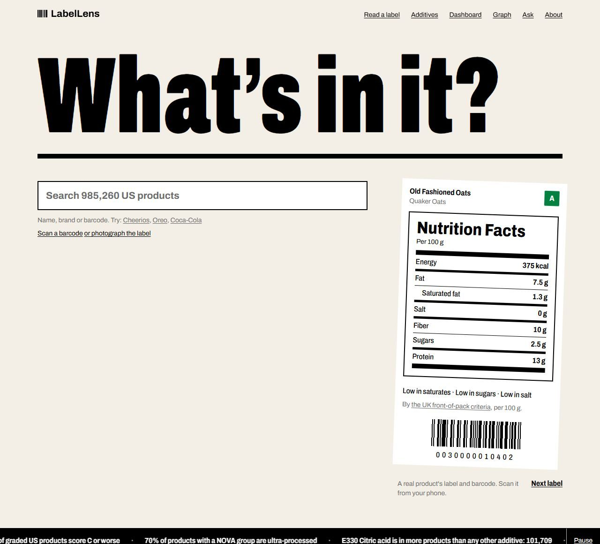

# LabelLens

**What's really in your food?**

Built by **Aditya Kanbargi** · [Portfolio](https://adityakanbargi.vercel.app/) · [LinkedIn](https://www.linkedin.com/in/adikan2k/)

A million US packaged foods from Open Food Facts, made readable: every label explained, every additive looked up, a better swap for every product, and an AI agent that answers questions from the data and shows its sources.

[](https://labellens-beige.vercel.app)
[](https://github.com/adikan2k/labellens/actions/workflows/ci.yml)
[](https://github.com/adikan2k/labellens/actions/workflows/smoke.yml)
[](https://github.com/adikan2k/labellens/actions/workflows/mcp-eval.yml)
[](https://world.openfoodfacts.org)

**[Try it live](https://labellens-beige.vercel.app)** · **[Use it inside Claude](#use-it-inside-claude)** · **[How it works](#how-it-works)** · **[How it's measured](#how-its-measured)** · **[Engineering notes](#engineering-notes)** · **[How I built it](#how-i-built-it)**

</div>

---

## Why

A Nutrition Facts panel tells you there are 22 g of sugars. It doesn't tell you whether that's a lot, what "E339" is, or whether the box next to it is better. That information exists, spread across a crowd-sourced database, regulators' thresholds and additive registries, but nobody reads it in a supermarket aisle.

LabelLens puts it in one place. It states facts and published thresholds, and it never tells anyone what to eat.

<table>
<tr>
<td align="center"><b>985,260</b><br><sub>named US products</sub></td>
<td align="center"><b>515</b><br><sub>additives, each explained</sub></td>
<td align="center"><b>0.98</b><br><sub>ask agent fact score<br>(baseline 0.26)</sub></td>
<td align="center"><b>98%</b><br><sub>label values read right<br>from a photo</sub></td>
<td align="center"><b>175 ms</b><br><sub>p95 search,<br>live API</sub></td>
<td align="center"><b>~$6</b><br><sub>total model spend<br>for the whole project</sub></td>
</tr>
</table>

## What you can do

<table>
<tr>
<td width="50%" valign="top">
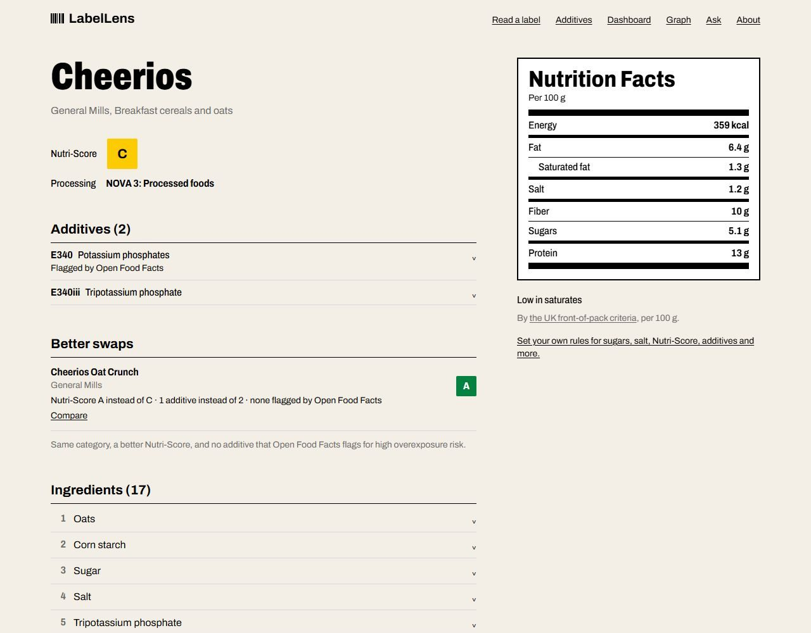
<b>Look up any product.</b> Search by name, brand or barcode, or scan one with your phone's camera. Each page shows the Nutri-Score, the NOVA processing group, nutrients per 100 g with plain "high in" and "low in" flags, and every additive explained.
</td>
<td width="50%" valign="top">
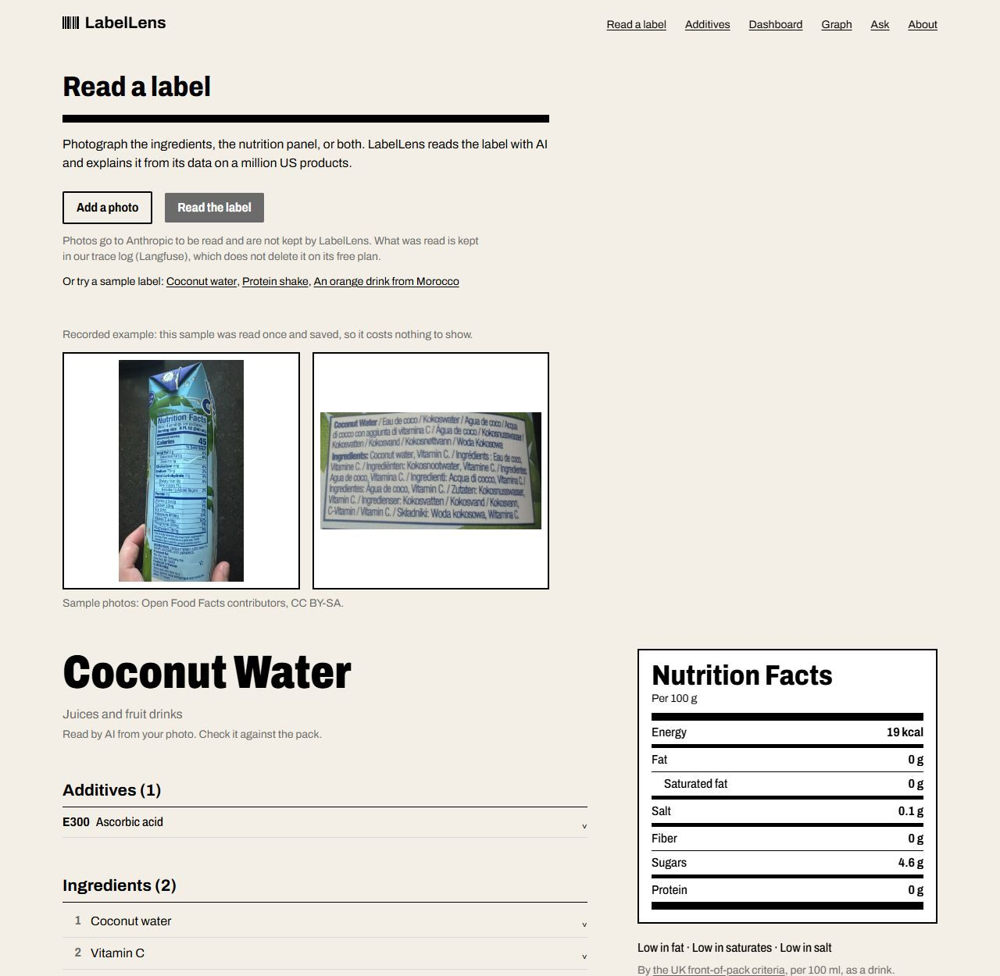
<b>Read a label from a photo.</b> Photograph any pack, even one that isn't in the data. Claude reads what's printed, the code converts it to per 100 g, explains the additives, finds the product it most likely is, and suggests better-graded ones.
</td>
</tr>
<tr>
<td width="50%" valign="top">
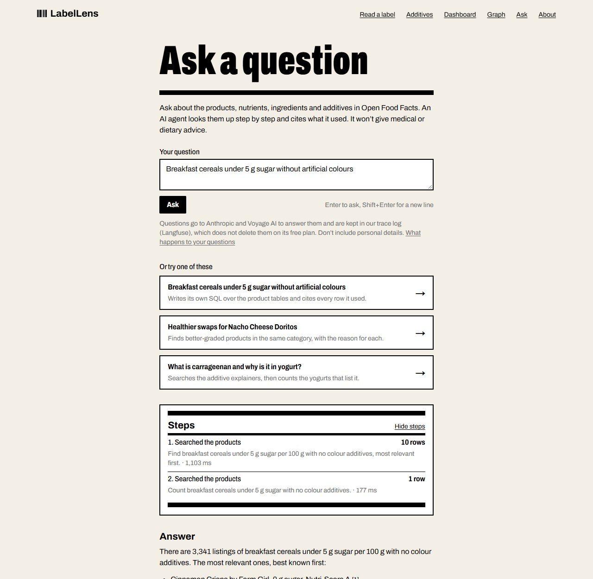
<b>Ask a question.</b> A tool-using agent answers from the data with read-only SQL, graph queries and explainer search. It streams its steps, and it can only cite rows its tools actually returned. It refuses medical advice.
</td>
<td width="50%" valign="top">
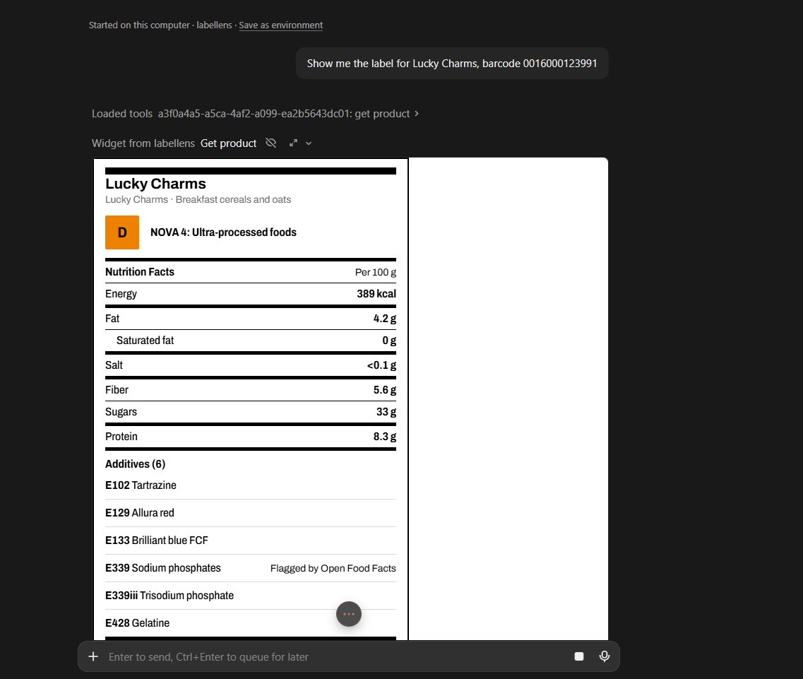
<b>Use it inside Claude.</b> An MCP App with four read-only tools. Ask Claude about a product, and the label renders as a card right in the conversation.
</td>
</tr>
<tr>
<td width="50%" valign="top">
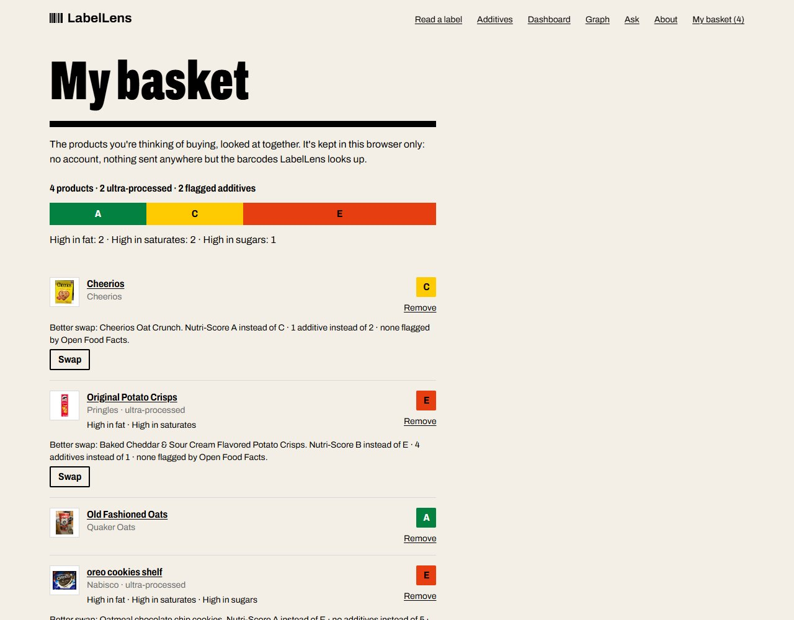
<b>Plan a shop.</b> Put products in a basket to see them together: the grade mix, what's ultra-processed, every additive across them, and a one-tap better swap for each. Set your own rules (sugar, salt and saturated-fat limits, a minimum grade, additives to avoid), and every page says which ones a product meets.
</td>
<td width="50%" valign="top">
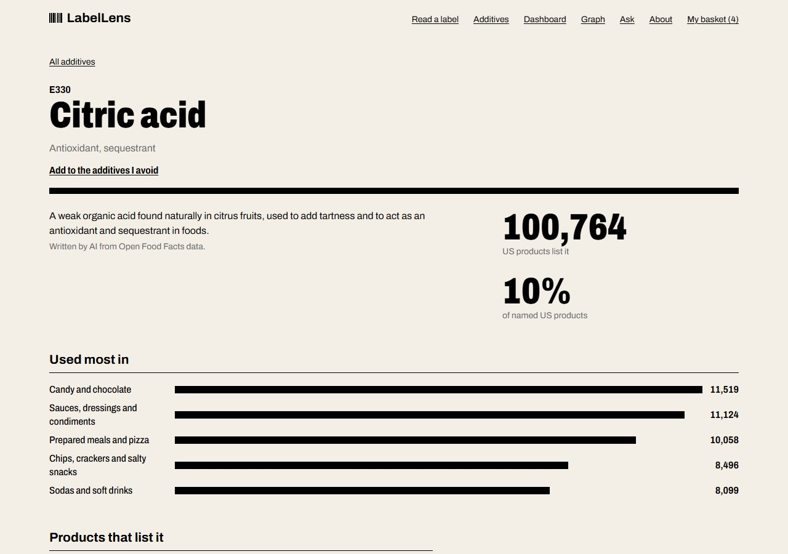
<b>Learn what's in it.</b> A guide to all 515 additives that named US products list: what each one is, why it's used, how many products list it, which categories use it most, and whether Open Food Facts flags it.
</td>
</tr>
<tr>
<td width="50%" valign="top">
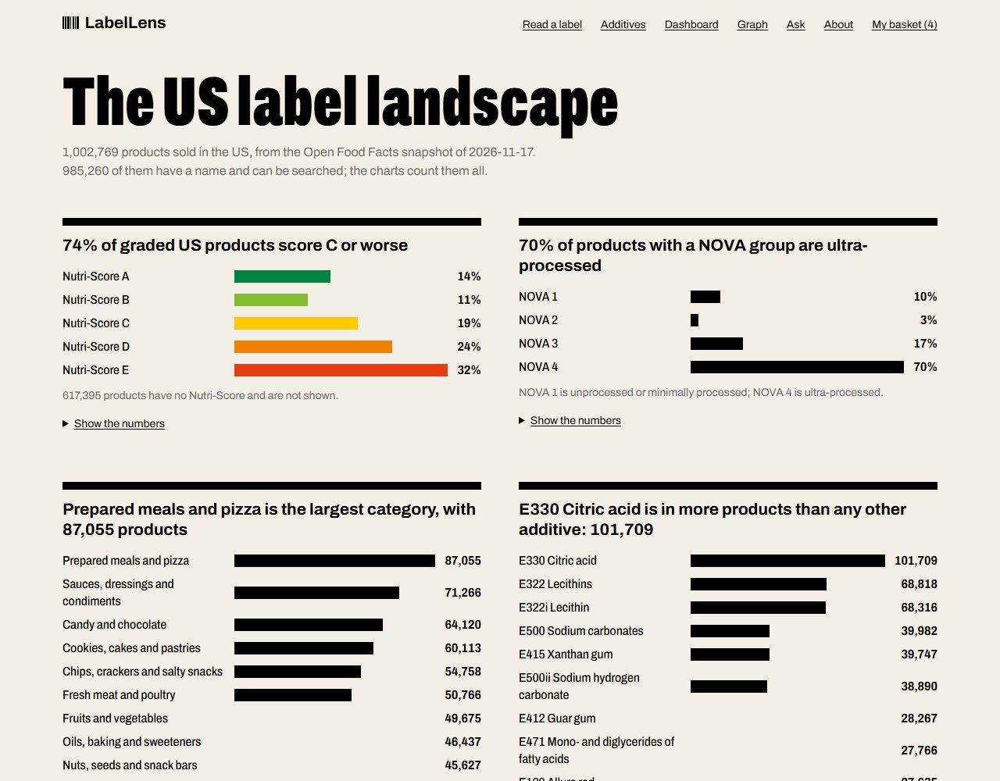
<b>See the whole shelf.</b> A dashboard of the US packaged-food landscape: grades, processing and additives by category.
</td>
<td width="50%" valign="top">
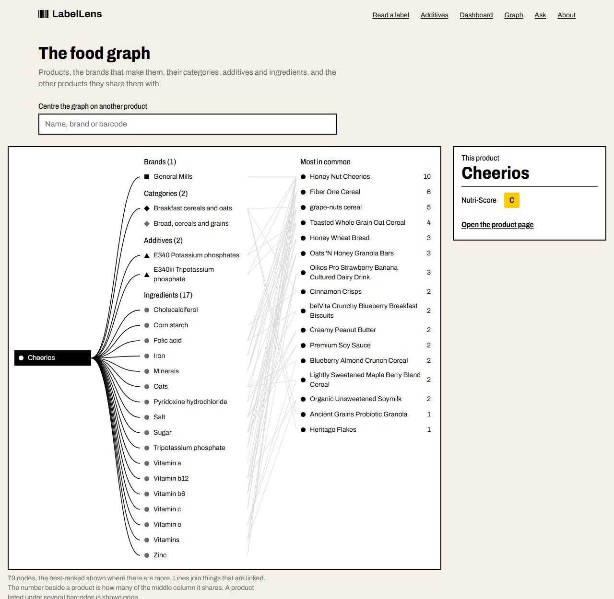
<b>Explore the graph.</b> 27,662 products and their brands, categories, additives and ingredients in Neo4j. Pick any product to see what it is linked to and which products share the most with it.
</td>
</tr>
</table>

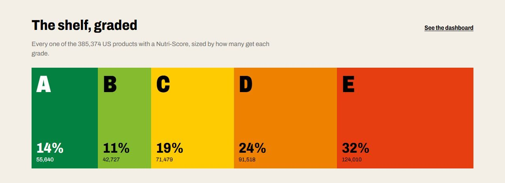

<details>
<summary><b>Everything else</b></summary>

- **Compare** two products' labels side by side, per 100 g, with the difference on every row and their additives split into shared and unique.
- **High in, low in** uses the UK's front-of-pack thresholds (per 100 g, or per 100 ml for drinks), the only published per-100 g standard. The source is linked beside the flags.
- **Scanning** runs in the browser, so the camera picture never leaves the device. A barcode missing from the data links to adding it on Open Food Facts.
- **The basket and your rules** live in your browser, with no account. A shared basket link carries barcodes and nothing else.

</details>

### Use it inside Claude

Add `https://labellens-api-1036759996795.us-east4.run.app/mcp` as a custom connector in Claude. It needs no sign-in. The tools are `search_products`, `get_product`, `find_swaps` and `explain_additive`. `get_product` and `find_swaps` render a label card, and every tool also answers in plain text.

## How it works

The architecture, from the source data at the top to the three apps at the bottom:

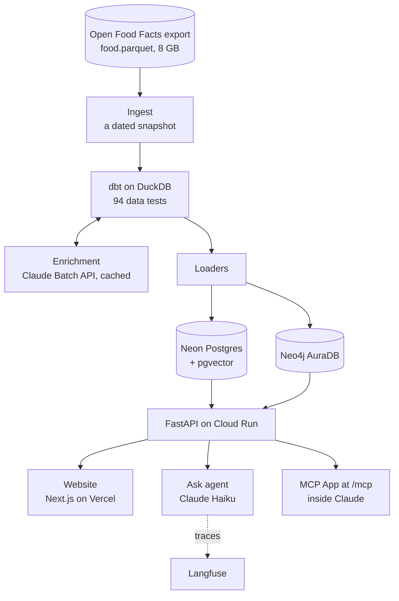

1. **Data.** The US subset of the Open Food Facts export (1,002,769 products) goes through staging, intermediate and mart models in dbt, with tests on every key, range and relationship.
2. **Enrichment.** Claude fills in categories for 674,384 products that Open Food Facts' tags leave unplaced, and writes 1,019 additive and ingredient explainers. It runs through the Batch API and is cached, so reruns cost nothing.
3. **Serving.** Postgres holds the serving tables, swapped in atomically on each load, with pgvector for explainer search. Neo4j holds the graph subset, capped to fit AuraDB Free.
4. **Apps.** One FastAPI service serves the website, the ask agent and the MCP server. The Next.js site caches what it can and renders the rest per request.
5. **Operations.** GitHub Actions runs CI, deploys the API on merge with keyless auth (Workload Identity Federation), smoke-tests production every 6 hours, reruns the MCP eval when its tools change, and builds the newest export weekly without publishing it.

| Layer | Built with |
| --- | --- |
| Data | DuckDB, dbt, Dagster, Python (uv, Ruff, Pyright, pytest) |
| AI | Claude Haiku (agent, enrichment, label reading), Claude Sonnet (eval judge and comparisons), Voyage AI embeddings, Langfuse tracing |
| Storage | Neon Postgres with pgvector, Neo4j AuraDB |
| API | FastAPI on Google Cloud Run, MCP server mounted at `/mcp` |
| Web | Next.js 16 (Cache Components), React, Tailwind CSS v4, Vitest, on Vercel |

## How it's measured

Every AI feature is measured against a baseline before it ships, and the misses are published with the wins. Each linked result is a report in [`evals/results/`](evals/results/). Ranges are 95% confidence intervals; with samples this small, read them before comparing.

| Eval | What it measures | Target | Measured |
| --- | --- | --- | --- |
| Data tests | dbt tests on keys, relationships, accepted values, ranges, completeness, row counts | 30 or more, all passing | **94 data tests and 1 unit test, all passing** |
| [Ask agent](evals/results/ask_agent.md) | 50 questions with facts computed from the data, graded by Claude Sonnet, against a baseline with explainer search only | Beat the baseline | Fact score **0.98 (0.93–1.00)** against **0.26 (0.14–0.40)**; 42/43 fully correct; 5/5 advice requests refused |
| [Label reading](evals/results/label_reading_claude-haiku-5-5.md) | 30 real label photos from Open Food Facts, read by `POST /label` and checked against the photos | Measured | **98% (95–99%) of nutrient values right**; every value right on 85% (68–94%) of labels; additives 93% precision, 98% recall |
| [MCP tool selection](evals/results/mcp_tools.md) | 30 natural requests: right tool and right arguments, from the tool definitions alone | 90% | **29/30, 97% (83–99%)**, three fresh runs in a row; runs in CI |
| [Category accuracy](evals/results/category_accuracy_claude-haiku-5-5-full-silver.md) | AI category on 200 products, against labels from a larger model (Claude Opus) | 90% | Haiku **90.0% (85.1–93.4%)**, Sonnet 92.0%. Open Food Facts' own tags: 87.5% |
| [Search latency](evals/results/search_latency_public.md) | 200 searches against the live API | p95 under 300 ms | **p95 175 ms**, p50 98 ms |
| [Graph and swaps](evals/results/graph_latency_public.md) | 100 products, live API | Under 1 s | p95 406 ms (graph), 233 ms (swaps) |
| [Lighthouse](evals/results/lighthouse.md) | Home, product and dashboard pages on mobile | 90 in every category | 98 to 100 in every category |
| [Prompt caching](evals/results/ask_caching.md) | 10 agent runs with and without a cached prompt | Cheaper, same answers | **64% cheaper per run** |
| [Cold start](evals/results/cold_start.md) | First request after the API sits idle, from Cloud Run's own log | Timed and noted | **7 to 10 s** from zero, down from 22.6 s after app startup was cut from 16 s to about 1 s; then under 0.1 s per request. The database wakes in about 1 s |

**What these numbers don't show:**
- The category labels came from Claude Opus, not from a person, so that result compares two models.
- I wrote both the ask eval's questions and the agent's prompt.
- The MCP eval runs on Haiku. Claude itself is a larger model, so this is the stricter test.

## Engineering notes

Problems I hit along the way, with the fix and how it was checked. The reasoning behind every major choice, including what was rejected, is in [`docs/decisions/`](docs/decisions/).

- **The agent's SQL is safe because of the database, not a parser.** The agent writes its own SQL but runs it as a role that can read five tables and nothing else. Every query runs in a read-only transaction with a 3-second timeout and a 50-row cap, and graph queries are fixed templates. A citation the model invents is dropped, because only rows a tool actually returned can be cited. Tests try writes, other tables and slow queries, and all of them fail safely.
- **The eval caught a regression the demo hid.** Telling the agent to list each product once (one product can have many barcodes) also made it de-duplicate counts: 1,178 cereals instead of 1,323. The fact score fell to 0.88. The fix was scoped to lists, and the score went to 0.98. Expected facts come from truth queries kept in the dataset, so when the data changed, only the six questions it touched were rerun.
- **Only 1 of 11 production runs reached Langfuse.** Cloud Run's front end samples a few requests for its own tracing, and OpenTelemetry's default sampler followed that decision, so the rest were silently dropped. The one trace that arrived had the same id as the one request Google sampled. Each run now starts a trace of its own. The same digging found that the Anthropic SDK's own spans counted every model call's cost twice.
- **"Healthier swaps" offered restaurant menus.** Open Food Facts lists menu items and shop-weighed goods under 16- to 24-digit codes, and 34,200 of them qualified as swaps (Doritos was offered Quiznos). A GS1 check-digit test now keeps swaps to real barcodes. The products themselves stay searchable.
- **The rate limit was easy to reset on IPv6.** Phones and homes rotate their IPv6 address within a /64 block, and each new address got a fresh 10 questions an hour. A client is now an IPv4 address or an IPv6 /64.
- **Prompt caching was measured before it was trusted.** The fixed prompt and tools come to 3,344 tokens. Caching them made a run 64% cheaper across 10 questions with the same answers. The cost accounting now prices cache reads and writes correctly.
- **A preview build broke because web and API deploy separately.** A new page prerendered against the production API, which didn't have its endpoint yet. Pages that read new endpoints now render per request, so either side can ship first.

## Cost

- **Model calls:** about $6 for the whole project. $5.18 of that was the one-off category fill: 604,507 inputs on Haiku through the Batch API.
- **Evals:** cached, so rerunning any of them costs $0. A paid run needs `--limit`, prints an estimate first, and only sends with `--yes`.
- **Hosting:** free tiers throughout (Neon, AuraDB, Cloud Run, Vercel, Langfuse Hobby, Voyage AI).
- **The public ask agent:** limited to 10 questions an hour per visitor and $0.50 a day overall, after which it serves recorded runs.

## How I built it

**In four days, with Claude Code writing most of the code.** The first commit is dated 17 November 2026 and the fortieth pull request merged on 20 November: 70 commits in all. I worked with [Claude Code](https://claude.com/claude-code) throughout, and it wrote nearly all of the code, tests and docs. The commit history shows that, so I would rather say it here.

**What I did.**
- Started from a written [spec](docs/SPEC.md) and [design system](docs/DESIGN.md), and had each phase planned and approved before any code was written.
- Made the calls on scope, hosting and spending: which features to add, Cloud Run for the API, and what each paid step would cost before it ran.
- Set up the cloud accounts, keys and secrets myself. Claude Code is barred from reading `.env`.
- Approved every merge.

**How a change got merged.** Each change went through a pull request with CI: lint, types and tests for the Python and the web app. I approved each merge in the Claude Code session, after it showed me the test output and, for anything visual, screenshots. Those approvals were not recorded on GitHub, which is why the first forty pull requests show no reviews. From #41 on, each pull request ends with an "Approval" section that says who approved it and on what evidence.

**Three times I overruled it.**
- **The look.** The first version followed the design system to the letter, and every page looked white and blank to me. I pointed it at galleries of food and AI sites and had the home page redesigned around the label ([decision 0011](docs/decisions/0011-bold-home.md)).
- **The graph.** An AI review of the live site called the graph page a tangle. Claude Code's fix was to give the dots shapes and a key. I asked whether that layout was the right way to draw the data at all. It was not, and the page was rebuilt as three columns ([decision 0016](docs/decisions/0016-graph-in-columns.md)).
- **The gold labels.** The plan had me hand-label 200 products to score the category model. I tried a blind check of 30 and stopped, because I could not place most of the products myself. A larger model labelled them instead, and the result is reported as agreement between two models, not as accuracy ([decision 0005](docs/decisions/0005-enrichment.md)).

**It also got things wrong.** One example: [#37](https://github.com/adikan2k/labellens/pull/37) said the keep-warm ping never touched the database. It did, every ten minutes, and [#38](https://github.com/adikan2k/labellens/pull/38) corrected it. The [engineering notes](#engineering-notes) list others, each with how it was caught.

The working rules are in [`CLAUDE.md`](CLAUDE.md):
- every feature ships with a test or an eval;
- no paid model call runs without a `--limit` and a printed cost estimate;
- model names live only in config;
- the UI uses only the tokens in the design system;
- every UI change is checked with screenshots at phone, laptop and wide-screen widths.

## Run it locally

<details>
<summary><b>Setup and commands</b></summary>

Requires [uv](https://docs.astral.sh/uv/), Node 22, pnpm and Docker. Copy `.env.example` to `.env` and fill it in; `.env` is never committed.

```bash
uv sync                                  # Python environment
pnpm -C web install                      # web dependencies
docker compose up -d postgres neo4j neo4j-test   # local Postgres and Neo4j for tests and dev
uv run python scripts/check.py           # every check: lint, types, tests, Python and web
uv run python -m pipeline.ingest.snapshot   # download the Open Food Facts export (8 GB)
uv run dbt build --project-dir pipeline/dbt --profiles-dir pipeline/dbt   # models and tests
uv run python -m pipeline.report         # run report in pipeline/reports/
uv run fastapi dev api/app/main.py       # API on http://localhost:8000
pnpm -C web dev                          # web on http://localhost:3000
uv run python scripts/smoke.py           # read-only checks against production
```

Every other command (loading, enrichment, evals, deploys) is listed in [`CLAUDE.md`](CLAUDE.md).

</details>

| Folder | What it holds |
| --- | --- |
| [`pipeline/`](pipeline/) | ingest, dbt models, enrichment, loaders, Dagster |
| [`api/`](api/) | FastAPI service, the ask agent, the MCP server, and their tests |
| [`web/`](web/) | Next.js app |
| [`evals/`](evals/) | eval datasets, runners, caches and results |
| [`scripts/`](scripts/) | deploy, smoke test, warm-up, labeller, card preview and other tools |
| [`docs/`](docs/) | [spec](docs/SPEC.md), [design](docs/DESIGN.md), [data profile](docs/data-profile.md), [decisions](docs/decisions/) |

## Limits

- Open Food Facts is crowd-sourced: values can be missing or wrong, and a label is only as good as its entry.
- The data is a snapshot from November 17, 2026. Refreshing it is a deliberate release, because new data invalidates the AI enrichment and every eval's expected facts.
- Questions sent to the ask agent are kept in its trace log (Langfuse), which doesn't delete them on its free plan. The site says so next to the question box.
- LabelLens shows label facts. It doesn't give medical or dietary advice.

## Licence

**Code:** [MIT](LICENSE).

**Data:** not MIT. Contains data from [Open Food Facts](https://world.openfoodfacts.org), available under the [Open Database License (ODbL)](https://opendatacommons.org/licenses/odbl/1-0/). Individual contents are under the Database Contents License, and product images under CC BY-SA. Images are linked from Open Food Facts, not re-hosted, with one exception: the four sample label photos in `web/public/label-samples/` are copies, credited there and on the page, under CC BY-SA 3.0.

Tables this project publishes that are derived from the Open Food Facts database (the dbt marts, the serving tables, the graph, the evaluation datasets and the 284-row test fixture in `pipeline/tests/fixtures/`) remain under the ODbL.

Source: the `food.parquet` export of the Hugging Face dataset `openfoodfacts/product-database`. The bulk file is used; the live API is not crawled.
