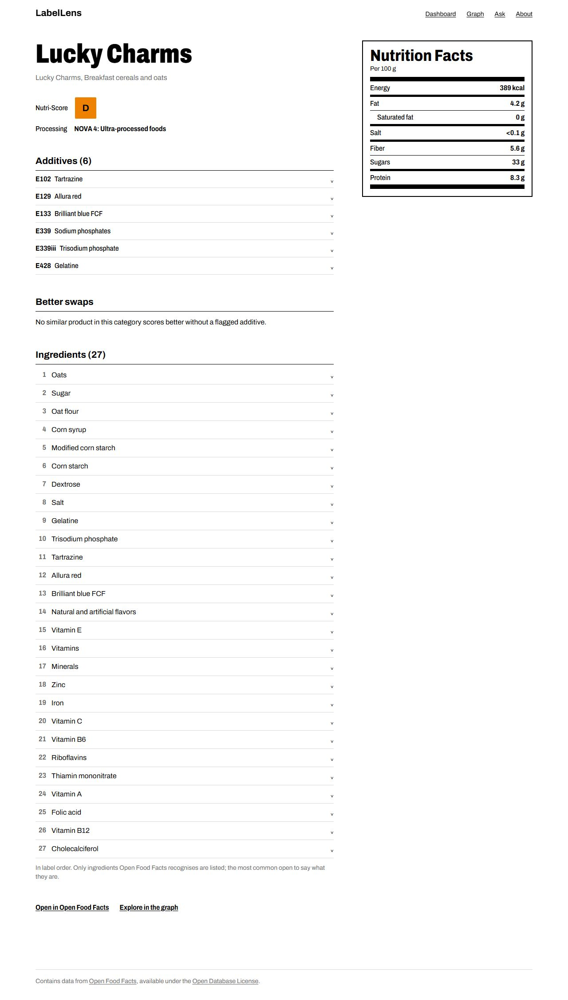
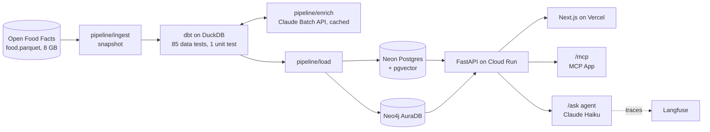

# LabelLens

LabelLens explains US food labels from the Open Food Facts database. It covers 985,260 named products. You can:
- search for a product and read its label: Nutri-Score, NOVA, nutrients per 100 g, and additives in plain English;
- find better swaps in the same category;
- explore a food knowledge graph;
- ask questions in plain English to an agent that shows its steps and cites its sources;
- use all of it from inside Claude as an MCP App.

**Live:**
- **Website:** [labellens-beige.vercel.app](https://labellens-beige.vercel.app)
- **In Claude:** add `https://labellens-api-1036759996795.us-east4.run.app/mcp` as a custom connector, with no sign-in.

It's built as one end-to-end system: a tested dbt pipeline, AI enrichment through the Batch API, Postgres with pgvector, Neo4j, a FastAPI service, a Next.js site, a tool-using agent and an MCP server. Every AI part is measured against a baseline, and the misses are published along with the wins.

| The product page | The label inside Claude (MCP App) |
| --- | --- |
|  |  |

## What's in it

- **Search and product pages.** Name, brand or barcode search with results as you type. Each page shows a Nutrition Facts panel per 100 g, the Nutri-Score and NOVA group, and additives with a short explainer. A flagged additive is marked when Open Food Facts flags it for a high overexposure risk.
- **Better swaps.** Similar products in the same category with a better Nutri-Score, no flagged additive and a real barcode, each with the reason it's better.
- **Compare.** Two products' labels side by side, per 100 g, with the difference on every row and their additives split into shared and unique. Open it from any product page or straight from a swap.
- **Dashboard.** The US packaged-food landscape: grades, processing and additives by category.
- **Graph explorer.** 27,662 products and their brands, categories, additives and ingredients in Neo4j.
- **Ask.** A Claude Haiku agent with three tools: read-only SQL, fixed Cypher templates, and vector search over explainers. It streams each step, cites the rows it used and refuses medical advice. Limits: 10 questions an hour per visitor and $0.50 a day overall, after which it serves recorded runs.
- **MCP App.** Four read-only tools, `search_products`, `get_product`, `find_swaps` and `explain_additive`. `get_product` and `find_swaps` render a label card inside Claude, and every tool also answers in plain text.

## Architecture



- **Data:** the US subset of the export (1,002,769 products) goes through staging, intermediate and mart models in dbt, with tests on every key, range and relationship.
- **Enrichment:** Claude fills in categories for 674,384 products that Open Food Facts' tags leave unplaced, and writes 1,019 additive and ingredient explainers.
- **Serving:** Postgres holds the serving tables, swapped in atomically on each load. Neo4j holds the graph subset, capped to fit AuraDB Free.
- **Operations:**
  - Dagster runs the pipeline locally.
  - GitHub Actions runs CI and a production smoke test every 6 hours.
  - A weekly pipeline build checks the newest export without publishing it.

## Results

Each linked result is a report in [`evals/results/`](evals/results/); the data-test count comes from `dbt build`. Ranges are 95% confidence intervals; with samples this small, read them before comparing.

| Eval | What it measures | Target | Measured |
| --- | --- | --- | --- |
| Data tests | dbt tests on keys, relationships, accepted values, ranges, completeness, row counts | 30 or more, all passing | **85 data tests and 1 unit test, all passing** |
| [Category accuracy](evals/results/category_accuracy_claude-haiku-5-5-full-silver.md) | AI category on 200 products, against labels from a larger AI model (Claude Opus), not a person | 90% | Haiku **90.0% (85.1–93.4%)**, Sonnet 92.0%. Open Food Facts' own tags: 87.5% |
| [Ask agent](evals/results/ask_agent.md) | 50 questions with facts computed from the data, graded by Claude Sonnet, against a baseline with explainer search only | Beat the baseline | Fact score **0.98 (0.93–1.00)** against **0.26 (0.14–0.40)**; 42/43 fully correct; 5/5 advice requests refused |
| [MCP tool selection](evals/results/mcp_tools.md) | 30 natural requests: right tool and right arguments, from the tool definitions alone | 90% | **29/30, 97% (83–99%)**, three fresh runs in a row; runs in CI |
| [Search latency](evals/results/search_latency_public.md) | 200 searches against the live API | p95 under 300 ms | **p95 184 ms**, p50 104 ms |
| [Graph and swaps](evals/results/graph_latency_public.md) | 100 products, live API | Under 1 s | p95 406 ms (graph), 233 ms (swaps) |
| [Lighthouse](evals/results/lighthouse.md) | Home, product and dashboard pages on mobile | 90 in every category | 98 to 100 in every category |
| [Prompt caching](evals/results/ask_caching.md) | 10 agent runs with and without a cached prompt | Cheaper, same answers | **64% cheaper per run** |
| [Cold start](evals/results/cold_start.md) | First request after Cloud Run and Neon both scaled to zero | Timed and noted | **22.6 s after an hour idle** (3.9 s after 25 minutes), then about 0.1 s; 16 s of it was startup, cut to 0.4 s since (not yet re-timed after an hour) |

**What these numbers don't show:**
- The category labels were made by Claude Opus, not by a person, so that result compares two models.
- The ask eval's questions were written by the same author as the agent's prompt.
- The MCP eval runs on Haiku. Claude itself is a larger model, so this is the stricter test.

## Engineering notes

A few problems found along the way, with the fix and how it was checked. The full reasoning is in [`docs/decisions/`](docs/decisions/).

- **The agent's SQL is safe because of the database, not a parser.** The agent writes its own SQL, but runs it as a role that can read five tables and nothing else. Every query runs in a read-only transaction with a 3-second timeout and a 50-row cap. Graph queries are fixed templates. A citation the model invents is dropped, because only rows a tool actually returned can be cited. Tests try writes, other tables and slow queries, and all of them fail safely.
- **The eval caught a regression the demo hid.** Telling the agent to list each product once (one product has many barcodes) also made it de-duplicate counts: 1,178 cereals instead of 1,323. The fact score fell to 0.88. The fix was scoped to lists, and the score went to 0.98. Expected facts come from truth queries kept in the dataset, so when the data changed, only the six questions it touched were rerun.
- **Only 1 of 11 production runs reached Langfuse.** Cloud Run's front end samples a few requests for its own tracing, and OpenTelemetry's default sampler followed that decision, so the rest were silently dropped. The one trace that arrived had the same id as the one request Google sampled. Each run now starts a trace of its own. The same digging found that the Anthropic SDK's own spans counted every model call's cost twice.
- **"Healthier swaps" offered restaurant menus.** Open Food Facts lists menu items and shop-weighed goods under 16- to 24-digit codes, and 34,200 of them qualified as swaps (Doritos was offered Quiznos). A GS1 check-digit test now keeps swaps to real barcodes. The products themselves stay searchable.
- **The rate limit was easy to reset on IPv6.** Phones and homes rotate their IPv6 address within a /64 block, and each new address got a fresh 10 questions an hour. A client is now an IPv4 address or an IPv6 /64.
- **Prompt caching was measured before it was trusted.** The fixed prompt and tools come to 3,344 tokens. Caching them made a run 64% cheaper across 10 questions with the same answers. The cost accounting now prices cache reads and writes correctly.

## Cost

- **Model calls:** about $6 for the whole project. $5.18 of that was the one-off category fill: 604,507 inputs on Haiku through the Batch API.
- **Evals:** cached, so rerunning any of them costs $0. A paid run needs `--limit`, prints an estimate first and only sends with `--yes`.
- **Hosting:** free tiers throughout (Neon, AuraDB, Cloud Run, Vercel, Langfuse Hobby, Voyage AI).
- **The public ask agent:** capped at $0.50 a day.

## Run it

Requires [uv](https://docs.astral.sh/uv/), Node 22, pnpm and Docker. Copy `.env.example` to `.env` and fill it in; `.env` is never committed.

```bash
uv sync                                  # Python environment
pnpm -C web install                      # web dependencies
docker compose up -d postgres neo4j neo4j-test   # local Postgres and Neo4j for tests and dev
uv run python scripts/check.py           # every check: lint, types, tests, Python and web
uv run python -m pipeline.ingest.snapshot   # download the Open Food Facts export (8 GB)
uv run dbt build --project-dir pipeline/dbt --profiles-dir pipeline/dbt   # models and tests
uv run python -m pipeline.report         # run report in pipeline/reports/
uv run fastapi dev api/app/main.py       # API on http://localhost:8000
pnpm -C web dev                          # web on http://localhost:3000
uv run python scripts/smoke.py           # read-only checks against production
```

Every other command (loading, enrichment, evals, deploys) is listed in [`CLAUDE.md`](CLAUDE.md).

| Folder | What it holds |
| --- | --- |
| `pipeline/` | ingest, dbt models, enrichment, loaders, Dagster |
| `api/` | FastAPI service, the ask agent, the MCP server, and their tests |
| `web/` | Next.js app |
| `evals/` | eval datasets, runners, caches and results |
| `scripts/` | deploy, smoke test, labeller, card preview and other tools |
| `docs/` | [spec](docs/SPEC.md), [design](docs/DESIGN.md), [data profile](docs/data-profile.md), [decision notes](docs/decisions/) |

## Limits

- Open Food Facts is crowd-sourced: values can be missing or wrong, and a label is only as good as its entry.
- The data is a snapshot from November 17, 2026. Refreshing it is a deliberate release, because new data invalidates the AI enrichment and every eval's expected facts.
- Questions sent to the ask agent are kept in its trace log (Langfuse), which doesn't delete them on its free plan. The site says so next to the question box.
- LabelLens shows label facts. It doesn't give medical or dietary advice.

## Data and licence

Contains data from [Open Food Facts](https://world.openfoodfacts.org), available under the [Open Database License (ODbL)](https://opendatacommons.org/licenses/odbl/1-0/). Individual contents are under the Database Contents License, and product images under CC BY-SA. Images are linked from Open Food Facts, not re-hosted.

Tables this project publishes that are derived from the Open Food Facts database (the dbt marts, the serving tables, the graph, the evaluation datasets and the 284-row test fixture in `pipeline/tests/fixtures/`) remain under the ODbL.

Source: the `food.parquet` export of the Hugging Face dataset `openfoodfacts/product-database`. The bulk file is used; the live API is not crawled.
